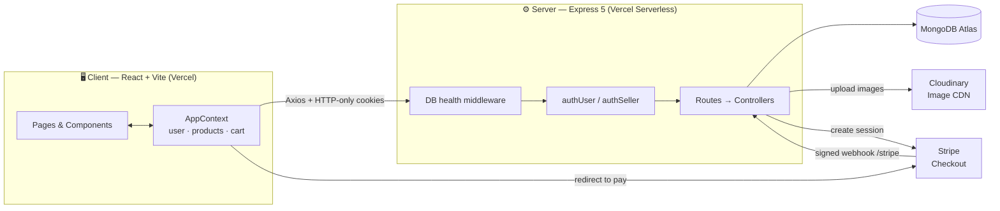
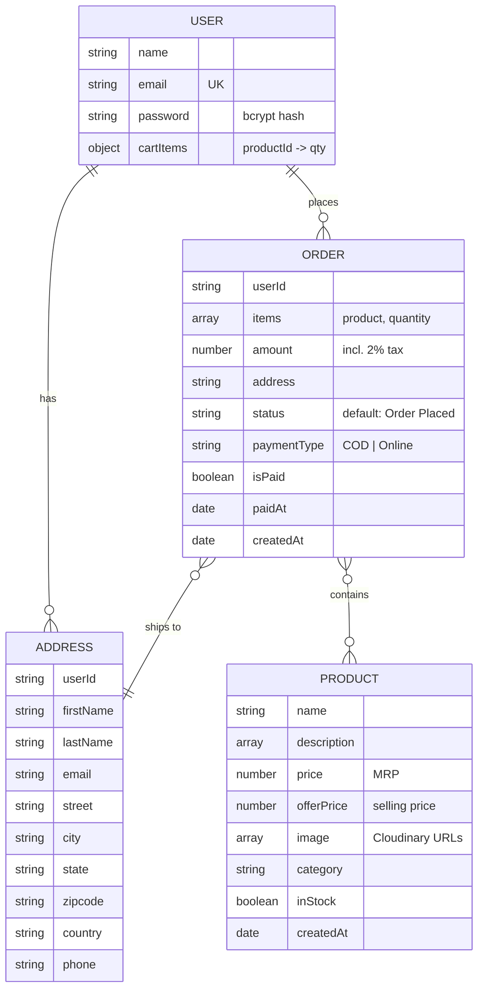

<div align="center">

# 🧺 FoodBasket

### Online Food & Grocery Delivery Platform

A full-stack **MERN** e-commerce web app where customers browse fresh groceries, build a cart that follows them across devices, and pay with **Cash on Delivery** or **Stripe**. A separate **seller dashboard** manages the catalogue, stock and incoming orders.

[](https://nodejs.org/)
[](https://react.dev/)
[](https://vite.dev/)
[](https://expressjs.com/)
[](https://mongoosejs.com/)
[](https://tailwindcss.com/)
[](https://stripe.com/)
[](https://vercel.com/)
[](#-license)

**[Features](#-features) · [Tech Stack](#-tech-stack) · [Getting Started](#-getting-started) · [API](#-api-reference) · [Deployment](#-deployment) · [Learning Guide](learning.md)**

</div>

---

## 📑 Table of Contents

- [Overview](#-overview)
- [Features](#-features)
- [Tech Stack](#-tech-stack)
- [Architecture](#-architecture)
- [How It Works](#-how-it-works)
- [Project Structure](#-project-structure)
- [Getting Started](#-getting-started)
- [Usage](#-usage)
- [Frontend Routes](#-frontend-routes)
- [API Reference](#-api-reference)
- [Data Models](#-data-models)
- [Security](#-security)
- [Deployment](#-deployment)
- [Testing Checklist](#-testing-checklist)
- [Challenges and Solutions](#-challenges-and-solutions)
- [Roadmap](#-roadmap)
- [Contributing](#-contributing)
- [Acknowledgements](#-acknowledgements)
- [License](#-license)
- [Author](#-author)

> 📘 **New to the codebase?** Read [`learning.md`](learning.md). It explains every file, the reasoning behind each technology, a 7-day build walkthrough and 20 interview questions with answers.

---

## 🌟 Overview

**FoodBasket** is a single-page, full-stack web application for ordering food and groceries online. It has two roles:

| Role | Capabilities |
|---|---|
| 🛒 **Customer** | Browse by category, search, view product details, manage a persistent cart, save delivery addresses, pay by COD or card (Stripe), and track order history. |
| 🏪 **Seller (Admin)** | Log in to a separate dashboard to add products with images, toggle stock, delete products, and view every order with the delivery address and payment status. |

Products are organised into seven categories: **Vegetables · Fruits · Drinks · Instant · Dairy · Bakery · Grains**.

### Why this project?
Small grocery sellers often lack an affordable way to sell online, and phone or manual ordering leads to pricing mistakes, no order history and no scalability. FoodBasket gives sellers a lightweight admin panel and customers a fast storefront. It also demonstrates a realistic, end-to-end e-commerce workflow:

- 🔐 Cookie-based JWT authentication with separate customer and seller sessions
- 💰 Prices calculated on the server, so the client can't tamper with totals
- 💳 Stripe Checkout with signed webhooks for payment confirmation
- ☁️ Image uploads to the Cloudinary CDN
- 🚀 Serverless deployment of both apps on Vercel

---

## ✨ Features

### 🛒 Customer
- **Accounts:** register and log in with email and password. Passwords are hashed with bcrypt, and the session lasts 7 days in an HTTP-only cookie.
- **Storefront:** hero banner, category tiles, best sellers, a "Why We Are the Best" section and a newsletter signup.
- **Browse and search:** All Products page with live navbar search, plus a page for each category.
- **Product details:** image gallery, MRP vs offer price, description bullets, related products, **Add to Cart** and **Buy now**. Out-of-stock items can't be bought.
- **Smart cart:**
  - quantity selector, remove button, and live subtotal, 2% tax and total
  - saved to the database automatically for logged-in users, so it follows them across devices
  - **guest cart merges** into the saved cart on login, so nothing is lost
  - products the seller deletes are removed from carts automatically
- **Address book:** save multiple addresses and pick one at checkout.
- **Payments:**
  - 💵 **Cash on Delivery:** the order is created instantly.
  - 💳 **Online (Stripe Checkout, INR):** the order is marked **Paid** only after Stripe confirms through a signed webhook. If the customer cancels, the cart is kept.
- **My Orders:** every order with its items, amount, payment method, **Paid / Pending** badge, status and date.
- **Polished UX:** toast notifications, loading and disabled buttons, an empty-cart state, a "Product not found" page and a responsive mobile menu.

### 🏪 Seller / Admin
- **Secure login** at `/seller` with a dedicated `sellerToken` cookie. Credentials come from environment variables.
- **Add Product:** up to 4 images (uploaded to Cloudinary), name, multi-line description, category, price and offer price, all validated.
- **Product List:** table of every product with an **In Stock** toggle switch and delete with a confirmation modal.
- **Orders:** every COD order and every paid online order, with items, customer address, amount, method and payment status.
- Out-of-stock products are hidden from the storefront automatically.

---

## 🛠 Tech Stack

| Layer | Technology | Why it was chosen |
|---|---|---|
| **Language** | JavaScript (ES Modules) | One language across client and server. |
| **Frontend** | React 19 + Vite 7 | Component-based UI; near-instant dev server and fast builds. |
| **Routing** | React Router 7 | SPA navigation and nested seller routes. |
| **State** | React Context API | Small global state (user, cart, products) without Redux boilerplate. |
| **HTTP** | Axios | Global `baseURL` / `withCredentials`, plus an interceptor for readable errors. |
| **Styling** | Tailwind CSS 4 (`@tailwindcss/vite`) | Utility-first, responsive, custom theme (`#4fbf8b`). |
| **UI extras** | react-hot-toast, lucide-react, Outfit font | Notifications, icons, typography. |
| **Backend** | Node.js + Express 5 | Minimal REST framework; async errors are handled automatically. |
| **Database** | MongoDB Atlas + Mongoose 8 | Document model suits products and carts; schemas plus `populate()`. |
| **Auth** | jsonwebtoken, bcryptjs, cookie-parser | Stateless sessions in HTTP-only cookies; salted password hashes. |
| **Uploads** | Multer + Cloudinary | Multipart parsing; CDN storage, since serverless has no permanent disk. |
| **Payments** | Stripe Checkout + Webhooks | Hosted, PCI-compliant payment page; trustworthy server-side confirmation. |
| **Tooling** | ESLint, Nodemon | Code quality and auto-restart during development. |
| **Hosting** | Vercel | Git-based deploys, CDN for the SPA, serverless functions for the API. |

---

## 🏗 Architecture



The backend follows an **MVC-style** layout: **routes** map URLs to **controllers** (business logic), which use **Mongoose models** (data shape), and **middlewares** handle cross-cutting concerns such as authentication.

---

## ⚙️ How It Works

### Authentication
1. On login, the server checks the password with `bcrypt.compare` and signs a JWT `{ id }` (7-day expiry).
2. The JWT is set as an **HTTP-only, Secure, SameSite** cookie, so JavaScript can't read it.
3. On every page load, the app calls `GET /api/user/is-auth` to restore the session and the saved cart.
4. Protected routes run `authUser` / `authSeller`, which verify the token. The user id **always comes from the token**, never from the request body.

### Cart sync
- The cart is an object `{ productId: quantity }` held in React Context.
- When it changes, a `useEffect` saves it with `POST /api/cart/update` (logged-in users only).
- On login, the guest cart is **merged** with the saved cart, keeping the larger quantity for each item.

### Checkout (online payment)
```mermaid
sequenceDiagram
    participant C as Customer (React)
    participant S as API (Express)
    participant DB as MongoDB
    participant ST as Stripe

    C->>S: POST /api/order/stripe {items, address}
    S->>DB: Check address owner, prices, stock
    S->>DB: Create Order (isPaid: false)
    S->>ST: Create Checkout Session (metadata: orderId, userId)
    S-->>C: { url }
    C->>ST: Redirect & pay
    ST->>S: Webhook checkout.session.completed (signed)
    S->>DB: Order.isPaid = true, paidAt; clear saved cart
    ST-->>C: Redirect /loader?next=my-orders
    C->>C: Clear local cart → My Orders
```

- **Pricing rule (server-side):** `subtotal = Σ(offerPrice × qty)`, `tax = floor(subtotal × 2%)`, `amount = subtotal + tax`. Shipping is free.
- **Abandoned checkout:** the `checkout.session.expired` webhook deletes the unpaid order.
- **COD** uses the same validation, creates the order immediately and clears the saved cart.

### Resilience
If the database is unreachable, the API answers immediately with `503 "Database is unavailable right now"` instead of hanging, and reconnects automatically once the database is back.

---

## 📁 Project Structure

```text
FoodBasket/
├── client/                          # React + Vite frontend
│   ├── public/                      # favicon
│   ├── src/
│   │   ├── assets/                  # images, icons, categories, footer links (assets.js)
│   │   ├── components/
│   │   │   ├── Navbar.jsx · Footer.jsx · Login.jsx · Loading.jsx
│   │   │   ├── MainBanner.jsx · Categories.jsx · BestSeller.jsx
│   │   │   ├── BottomBanner.jsx · NewsLetter.jsx · ProductCard.jsx
│   │   │   └── seller/SellerLogin.jsx
│   │   ├── context/AppContext.jsx   # global state, cart logic, API sync
│   │   ├── pages/
│   │   │   ├── Home · AllProducts · ProductCategory · ProductDetails
│   │   │   ├── Cart · AddAddress · MyOrders
│   │   │   └── seller/ SellerLayout · AddProduct · ProductList · Orders
│   │   ├── App.jsx                  # routes
│   │   ├── main.jsx                 # entry + axios defaults
│   │   └── index.css                # Tailwind + theme
│   ├── vercel.json                  # SPA rewrite rule
│   ├── vite.config.js
│   └── package.json
├── server/                          # Express REST API
│   ├── configs/                     # db.js · cloudinary.js · multer.js · cookie.js
│   ├── controllers/                 # user · seller · product · cart · address · order
│   ├── middlewares/                 # authUser.js · authSeller.js
│   ├── models/                      # User · Product · Address · Order
│   ├── routes/                      # *Route.js
│   ├── server.js                    # app entry (exports app for Vercel)
│   ├── vercel.json                  # serverless config
│   └── package.json
├── greencart_assets/                # original design asset pack
├── learning.md                      # full learning guide
└── README.md
```

---

## 🚀 Getting Started

### Prerequisites
- **Node.js 18+** and **npm**
- A **MongoDB** database (a free [MongoDB Atlas](https://www.mongodb.com/atlas) M0 cluster works)
- A **[Cloudinary](https://cloudinary.com/)** account
- A **[Stripe](https://stripe.com/)** account in test mode, plus the **[Stripe CLI](https://stripe.com/docs/stripe-cli)** for local webhooks

### 1. Clone the repository
```bash
git clone https://github.com/AdvikaChaithra/FoodBasket.git
cd FoodBasket
```

### 2. Install dependencies
```bash
cd server && npm install
cd ../client && npm install
```

### 3. Configure environment variables

**`server/.env`**
```env
PORT=4000
NODE_ENV=development

# Database
MONGODB_URI=mongodb+srv://<user>:<password>@<cluster>.mongodb.net/foodbasket?retryWrites=true&w=majority

# Auth
JWT_SECRET=replace_with_a_long_random_string

# Seller (admin) login
SELLER_EMAIL=seller@example.com
SELLER_PASSWORD=choose_a_strong_password

# Cloudinary
CLOUDINARY_CLOUD_NAME=your_cloud_name
CLOUDINARY_API_KEY=your_api_key
CLOUDINARY_API_SECRET=your_api_secret

# Stripe
STRIPE_SECRET_KEY=sk_test_xxx
STRIPE_WEBHOOK_SECRET=whsec_xxx

# Optional: fallback return URL for Stripe
FRONTEND_URL=http://localhost:5173
```

**`client/.env`**
```env
VITE_BACKEND_URL=http://localhost:4000
VITE_CURRENCY=₹
```

> 🔒 `.env` files are git-ignored. Never commit real keys.

### 4. Run the app
```bash
# Terminal 1: API → http://localhost:4000
cd server
npm run server
```
```bash
# Terminal 2: Web → http://localhost:5173
cd client
npm run dev
```

### 5. (Optional) Forward Stripe webhooks locally
```bash
stripe listen --forward-to localhost:4000/stripe
```
Copy the printed `whsec_...` secret into `STRIPE_WEBHOOK_SECRET` and restart the API.

### Available scripts

| Location | Command | Description |
|---|---|---|
| `server/` | `npm run server` / `npm run dev` | Start the API with Nodemon (auto-restart) |
| `server/` | `npm start` | Start the API with Node |
| `client/` | `npm run dev` | Start the Vite dev server |
| `client/` | `npm run build` | Production build to `client/dist` |
| `client/` | `npm run preview` | Preview the production build |
| `client/` | `npm run lint` | Run ESLint |

---

## 🧭 Usage

### As a seller (set up the catalogue first)
1. Open `http://localhost:5173/seller` and log in with `SELLER_EMAIL` / `SELLER_PASSWORD`.
2. **Add Product:** upload up to 4 images and fill in the name, description (one bullet per line), category, price and offer price.
3. **Product List:** toggle stock or delete products.
4. **Orders:** review COD and paid orders with delivery details.

### As a customer
1. Open `http://localhost:5173`, then browse categories or search.
2. Open a product → **Add to Cart** or **Buy now**.
3. Log in or register (you'll be prompted when placing an order; your guest cart is kept).
4. In the cart, click **Change → Add address** and save a delivery address.
5. Choose **Cash On Delivery** or **Online Payment** and place the order.
   For Stripe test mode, use card `4242 4242 4242 4242`, any future expiry and any CVC.
6. Open **My Orders** from the profile menu.

---

## 🗺 Frontend Routes

| Route | Page | Access |
|---|---|---|
| `/` | Home | Public |
| `/products` | All products (search-aware) | Public |
| `/products/:category` | Category listing | Public |
| `/products/:category/:id` | Product details | Public |
| `/cart` | Cart and checkout | Public (login required to order) |
| `/add-address` | Add delivery address | Customer |
| `/my-orders` | Order history | Customer |
| `/loader?next=my-orders` | Post-payment loader (redirects after 5 s) | Public |
| `/seller` | Add Product (login screen if signed out) | Seller |
| `/seller/product-list` | Manage products | Seller |
| `/seller/orders` | All orders | Seller |

---

## 📡 API Reference

**Base URL:** `http://localhost:4000` (local) · your Vercel backend URL (production)

- **Auth:** HTTP-only cookies. `token` is the customer cookie and `sellerToken` is the seller cookie. Browser requests must send credentials (`axios.defaults.withCredentials = true`).
- **Response shape:** `{ "success": true | false, "message": "...", ...data }`
- **Database down:** every `/api/*` route returns `503 { success: false, message: "Database is unavailable right now..." }`.

### 👤 User: `/api/user`
| Method | Endpoint | Auth | Body | Description |
|---|---|---|---|---|
| POST | `/register` | – | `{ name, email, password }` (password ≥ 6 chars) | Create an account and set the `token` cookie |
| POST | `/login` | – | `{ email, password }` | Log in and set the `token` cookie |
| GET | `/is-auth` | User | – | Current user (without password) plus `cartItems` |
| GET | `/logout` | – | – | Clear the `token` cookie |

### 🏪 Seller: `/api/seller`
| Method | Endpoint | Auth | Body | Description |
|---|---|---|---|---|
| POST | `/login` | – | `{ email, password }` | Log in and set the `sellerToken` cookie |
| GET | `/is-auth` | Seller | – | Check the seller session |
| GET | `/logout` | – | – | Clear the `sellerToken` cookie |

### 📦 Products: `/api/product`
| Method | Endpoint | Auth | Body / Params | Description |
|---|---|---|---|---|
| GET | `/list` | – | – | All products, newest first |
| GET | `/id/:id` | – | `id` | Single product |
| POST | `/add` | Seller | `multipart/form-data`: `productData` (JSON string) + `images` (≤ 4 files) | Upload images to Cloudinary and create the product |
| POST | `/stock` | Seller | `{ id, inStock: boolean }` | Toggle availability |
| DELETE | `/delete/:id` | Seller | `id` | Delete a product |

`productData` example:
```json
{
  "name": "Fresh Tomato",
  "description": ["Farm fresh", "Rich in vitamin C"],
  "category": "Vegetables",
  "price": 40,
  "offerPrice": 32
}
```
`category` must be one of `Vegetables`, `Fruits`, `Drinks`, `Instant`, `Dairy`, `Bakery` or `Grains`. `offerPrice` must be ≤ `price`.

### 🛒 Cart: `/api/cart`
| Method | Endpoint | Auth | Body | Description |
|---|---|---|---|---|
| POST | `/update` | User | `{ cartItems: { "<productId>": quantity } }` | Save the cart (invalid entries are dropped) |

### 📍 Address: `/api/address`
| Method | Endpoint | Auth | Body | Description |
|---|---|---|---|---|
| POST | `/add` | User | `{ address: { firstName, lastName, email, street, city, state, zipcode, country, phone } }` | Save an address |
| GET | `/get` | User | – | List the user's addresses |

### 🧾 Orders: `/api/order`
| Method | Endpoint | Auth | Body | Description |
|---|---|---|---|---|
| POST | `/cod` | User | `{ items: [{ product, quantity }], address }` | Place a Cash on Delivery order |
| POST | `/stripe` | User | `{ items: [{ product, quantity }], address }` | Create the order plus a Stripe Checkout session → `{ url }` |
| GET | `/user` | User | – | The user's orders (newest first, populated) |
| GET | `/seller` | Seller | – | All COD orders plus paid online orders |

### 🔔 Stripe webhook
| Method | Endpoint | Auth | Handles |
|---|---|---|---|
| POST | `/stripe` (root path, **not** under `/api`) | Stripe signature | `checkout.session.completed` → mark paid · `checkout.session.expired` → delete the unpaid order |

**Example responses**
```json
{ "success": true, "message": "Order placed successfully" }
```
```json
{ "success": false, "message": "Tomato is out of stock" }
```

---

## 🗃 Data Models



---

## 🔐 Security

| Concern | How FoodBasket handles it |
|---|---|
| Password storage | bcrypt with 10 salt rounds; the hash is never returned to the client. |
| Session theft (XSS) | JWT in an **HTTP-only** cookie, which JavaScript can't read. |
| Transport | `secure` cookies and `SameSite=None` in production; `SameSite=Strict` locally. |
| Price tampering | Totals and Stripe line items are calculated on the server from database prices. |
| Fake payments | Webhooks are verified with `STRIPE_WEBHOOK_SECRET`; orders are only marked paid there. |
| Acting as another user | User id comes from the verified token; address ownership is checked on every order. |
| Input validation | ObjectId checks, positive whole-number quantities, category allow-list, price rules, password length. |
| Admin access | Separate `sellerToken` cookie plus a `SELLER_EMAIL` match in `authSeller`. |
| File uploads | Seller auth runs **before** Multer; max 4 images; temp files are deleted. |
| User enumeration | Generic "Invalid email or password" message. |
| Open redirect | `/loader?next=` only accepts internal paths. |
| Card data | Never touches the server (Stripe-hosted Checkout). |
| Secrets | Environment variables only; `.env` is git-ignored. |

---

## ☁️ Deployment

Both apps deploy to **Vercel** as two separate projects from this repository.

### Backend (`server/`)
1. Import the repo into Vercel with **Root Directory** set to `server`.
2. `vercel.json` builds `server.js` with `@vercel/node` and routes every path to it. `server.js` exports the Express app, so it runs as a serverless function.
3. Add every variable from `server/.env` in **Settings → Environment Variables**, with `NODE_ENV=production`.
4. In **MongoDB Atlas → Network Access**, allow `0.0.0.0/0`, because Vercel's IP addresses change.
5. In **Stripe → Developers → Webhooks**, add `https://<your-backend>.vercel.app/stripe` with the events `checkout.session.completed` and `checkout.session.expired`. Copy the signing secret into `STRIPE_WEBHOOK_SECRET`.

### Frontend (`client/`)
1. Import the repo again with **Root Directory** set to `client` (framework: Vite).
2. Set `VITE_BACKEND_URL=https://<your-backend>.vercel.app` and `VITE_CURRENCY=₹`.
3. `vercel.json` rewrites every path to `/`, so React Router can handle deep links like `/cart` on refresh.

**Live Demo:** *add your frontend URL here*
**API:** `https://food-basket-backend.vercel.app`

---

## ✅ Testing Checklist

| Scenario | Expected result |
|---|---|
| Register with a new email | Account created, logged in, cookie set |
| Register with an existing email | "User already exists" |
| Login with a wrong password | "Invalid email or password" |
| Add items as a guest, then log in | Guest cart merged with the saved cart |
| Refresh after adding items while logged in | Cart persists (saved in MongoDB) |
| Place a COD order | Order saved; shown in My Orders and seller Orders; cart cleared |
| Stripe payment with `4242 4242 4242 4242` | Redirect to Stripe → back to My Orders; order **Paid** via webhook |
| Cancel on the Stripe page | Back to the cart with items intact |
| Seller marks a product out of stock | Product hidden from the storefront and can't be ordered |
| Customer calls `/api/order/seller` | "Not Authorized" |
| Offer price above price | Rejected in the UI and by the API |
| Database unreachable | Instant "Database is unavailable" toast |

```bash
cd client && npm run lint && npm run build
```

---

## 🧩 Challenges and Solutions

| Challenge | Solution |
|---|---|
| Stripe signature checks need the **raw** body, but `express.json()` parses it first. | Register `POST /stripe` with `express.raw()` **before** `express.json()`. |
| Prices sent from the browser could be edited. | The client sends only ids and quantities; the server looks up prices and computes the totals. |
| Cookies across two domains (frontend and backend on separate Vercel projects). | `httpOnly` + `secure` + `SameSite=None` in production; CORS with credentials; Axios `withCredentials`. |
| Unpaid or abandoned online orders cluttering the seller view. | The seller sees only COD or paid orders; the `checkout.session.expired` webhook deletes stale unpaid orders. |
| Guest cart lost on login. | Merge the guest and saved carts on login, keeping the larger quantity per item. |
| No permanent disk on serverless. | Images go to Cloudinary; temp upload files are deleted after each request. |
| Queries hanging when the database is down. | Mongoose buffering disabled, plus a fail-fast 503 middleware with automatic reconnect. |
| Float rounding in payment amounts. | Amounts converted to paise with `Math.round(value × 100)`. |

---

## 🛣 Roadmap

- [ ] Seller order-status updates (Packed → Shipped → Delivered) and customer tracking
- [ ] Email or SMS order notifications
- [ ] Real product reviews and ratings; wishlist
- [ ] Coupons, delivery slots and delivery-fee rules
- [ ] Pagination, sorting and filters on listings
- [ ] Multi-seller support with role-based access
- [ ] Admin analytics (sales, top products, low-stock alerts)
- [ ] `helmet`, rate limiting and schema validation (Zod/Joi)
- [ ] Automated tests (Jest + Supertest, React Testing Library) and CI with GitHub Actions
- [ ] Docker setup for one-command local development

---

## 🤝 Contributing

Contributions, bug reports and ideas are welcome.

1. Fork the repository.
2. Create a branch: `git checkout -b feature/your-feature`
3. Commit: `git commit -m "Add your feature"`
4. Push: `git push origin feature/your-feature`
5. Open a Pull Request describing what changed and why.

For bugs, open an issue with steps to reproduce, the expected behaviour and screenshots.

---

## 🙏 Acknowledgements

- [React](https://react.dev/) · [Vite](https://vite.dev/) · [React Router](https://reactrouter.com/) · [Tailwind CSS](https://tailwindcss.com/)
- [Express](https://expressjs.com/) · [Mongoose](https://mongoosejs.com/) · [MongoDB Atlas](https://www.mongodb.com/atlas)
- [Stripe Checkout and Webhooks](https://stripe.com/docs/payments/checkout) · [Cloudinary](https://cloudinary.com/documentation) · [Multer](https://github.com/expressjs/multer)
- [Lucide Icons](https://lucide.dev/) · [react-hot-toast](https://react-hot-toast.com/)
- UI illustrations and product images come from the *GreenCart* asset pack in `greencart_assets/`. Check its license before commercial use.

---

## 📄 License

Released under the **MIT License**.

---

## 👩‍💻 Author

**Advika**

- GitHub: [@AdvikaChaithra](https://github.com/AdvikaChaithra)
- Repository: [AdvikaChaithra/FoodBasket](https://github.com/AdvikaChaithra/FoodBasket)

<div align="center">

⭐ If you found this project helpful, consider giving it a star!

</div>
