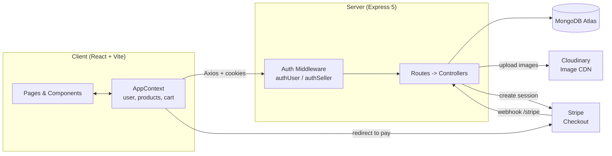
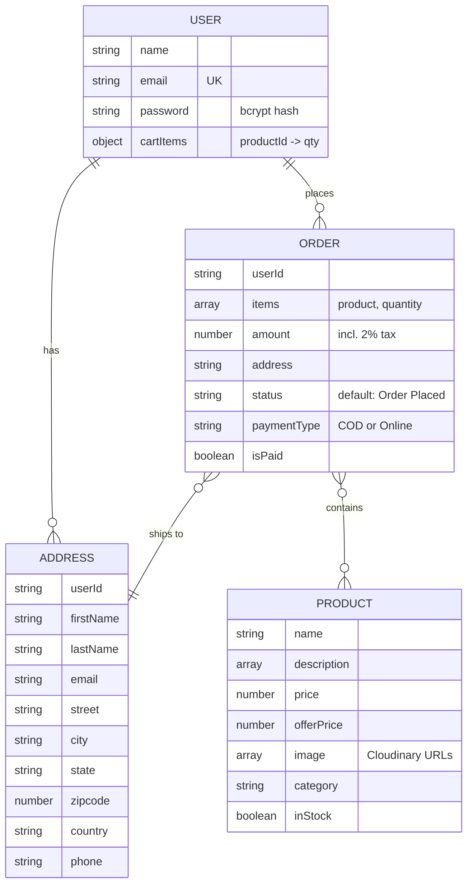

# FoodBasket — Online Food & Grocery Delivery Platform

> A full-stack MERN e-commerce web app where customers browse fresh food and grocery products, build a cart, and pay by Cash on Delivery or Stripe, while a seller/admin dashboard manages the catalogue and incoming orders.

[]()
[]()
[]()
[]()
[]()
[]()
[]()

## Table of Contents

- [Overview](#overview)
- [Problem Statement](#problem-statement)
- [Objectives](#objectives)
- [Features](#features)
- [Technology Stack](#technology-stack)
- [System Architecture](#system-architecture)
- [Screenshots and Demo](#screenshots-and-demo)
- [Project Structure](#project-structure)
- [Prerequisites](#prerequisites)
- [Installation and Setup](#installation-and-setup)
- [Usage](#usage)
- [API Documentation](#api-documentation)
- [Data Models](#data-models)
- [Testing and Results](#testing-and-results)
- [Challenges and Solutions](#challenges-and-solutions)
- [Limitations](#limitations)
- [Future Enhancements](#future-enhancements)
- [Security](#security)
- [Deployment](#deployment)
- [Contributing](#contributing)
- [References and Acknowledgements](#references-and-acknowledgements)
- [License](#license)
- [Author](#author)

## Overview

**FoodBasket** is a single-page, full-stack web application for ordering food and grocery items online. It is built on the MERN stack (MongoDB, Express, React, Node.js) and has two user roles:

- **Customers** can browse products by category, search by name, view product details, manage a persistent cart, save delivery addresses, place orders (Cash on Delivery or online card payment via Stripe), and view their order history.
- **Seller / Admin** can log in to a separate dashboard to add products with images, toggle stock availability, delete products, and view all customer orders.

The project is intended as a realistic, end-to-end example of an e-commerce workflow: authentication with HTTP-only cookies, role-based route protection, image uploads to a cloud CDN, server-side price calculation, and payment confirmation through Stripe webhooks.

Products are organised into seven categories: **Vegetables, Fruits, Drinks, Instant Food, Dairy, Bakery, and Grains**.

## Problem Statement

Small food and grocery sellers often lack an affordable way to sell online, and customers want a simple experience: find items quickly, see accurate prices, pay securely, and track what they ordered. Manual or phone-based ordering causes mistakes in pricing and stock, offers no order history, and does not scale.

FoodBasket addresses this by giving sellers a lightweight admin panel for catalogue and order management, and giving customers a fast storefront with a cart that follows them across sessions and devices.

## Objectives

- Build a responsive storefront with category browsing, search, and product detail pages.
- Implement secure customer and seller authentication using JWT stored in HTTP-only cookies.
- Persist each customer's cart in the database so it survives logout and device changes.
- Support two payment flows: Cash on Delivery and Stripe Checkout with webhook-based confirmation.
- Calculate order totals on the server from database prices so the client cannot tamper with amounts.
- Provide a seller dashboard for product, stock, and order management with Cloudinary-hosted images.
- Keep the codebase deployable to Vercel (frontend and backend).

## Features

### Customer

- **Registration and login:** Email and password accounts, passwords hashed with bcrypt, session kept in a 7-day HTTP-only cookie.
- **Product browsing:** Home page with banners, category tiles, and best sellers; "All Products" page; per-category pages.
- **Live search:** Search box filters products by name.
- **Product details:** Image gallery, MRP versus offer price, description bullets, related products from the same category, "Add to Cart" and "Buy now".
- **Smart cart:** Quantity selector, item removal, running totals, and automatic sync to the backend whenever the cart changes (for logged-in users).
- **Address book:** Save multiple delivery addresses and pick one at checkout.
- **Two payment options:**
  - *Cash on Delivery:* order created immediately.
  - *Online (Stripe Checkout, INR):* redirected to Stripe; order is marked paid only after Stripe confirms through a signed webhook.
- **Order history:** "My Orders" lists past orders with items, payment type, amount, status, and date.
- **Toast notifications:** Instant feedback for cart actions, errors, and order results.

### Seller / Admin

- **Separate login:** Credentials are configured through environment variables; authenticated through a dedicated `sellerToken` cookie.
- **Add product:** Up to 4 images per product uploaded to Cloudinary, with name, multi-line description, category, price, and offer price (validated so offer price is not above the price).
- **Product list:** View all products, toggle **In Stock / Out of Stock**, and delete with a confirmation modal.
- **Orders:** View all COD orders and all paid online orders with customer address and items.
- Out-of-stock products are automatically hidden from the customer storefront.

## Technology Stack

| Component | Technology | Purpose |
|---|---|---|
| Programming Language | JavaScript (ES Modules) | Used on both client and server |
| Frontend | React 19, Vite 7, React Router 7 | SPA, routing, build tooling |
| Styling | Tailwind CSS 4 (`@tailwindcss/vite`), Outfit font | Responsive UI and theme (`#4fbf8b` primary) |
| UI Utilities | react-hot-toast, lucide-react | Notifications and icons |
| State Management | React Context API | Auth, products, cart, search state |
| HTTP Client | Axios (`withCredentials`) | API calls with cookie authentication |
| Backend | Node.js, Express 5 | REST API and business logic |
| Database | MongoDB with Mongoose 8 | Users, products, addresses, orders |
| Authentication | JWT (`jsonwebtoken`), bcryptjs, cookie-parser | Stateless sessions, password hashing |
| File Uploads | Multer + Cloudinary | Product image upload and CDN hosting |
| Payments | Stripe Checkout + Webhooks | Online card payments (INR) |
| Tools | ESLint, Nodemon, Vercel | Linting, dev server, deployment |

## System Architecture

The React SPA talks to the Express REST API over HTTPS using cookie-based JWT authentication. The API persists data in MongoDB, stores images on Cloudinary, and creates Stripe Checkout sessions. Stripe notifies the API about payment results via a signed webhook.



**Order flow (online payment):**

1. Customer clicks *Proceed to Checkout* -> `POST /api/order/stripe`.
2. Server recomputes the amount from DB prices (+2% tax), creates an unpaid `Order`, and creates a Stripe Checkout session carrying `orderId` and `userId` in metadata.
3. Customer pays on Stripe's hosted page and returns to `/loader?next=my-orders`.
4. Stripe calls `POST /stripe`; the server verifies the signature, marks the order `isPaid: true`, and clears the user's saved cart. On `payment_intent.payment_failed` the pending order is deleted.

## Screenshots and Demo

> Add your screenshots to `docs/screenshots/` and update the paths below.

| Home | Product Details |
|---|---|
|  |  |

| Cart & Checkout | My Orders |
|---|---|
|  |  |

| Seller: Add Product | Seller: Orders |
|---|---|
|  |  |

**Live Demo:** [Add URL if deployed]

**Demo Video:** [Add URL if available]

## Project Structure

```text
OnlineFoodDelivery/
├── client/                          # React + Vite frontend
│   ├── public/
│   ├── src/
│   │   ├── assets/                  # Images, icons, categories list (assets.js)
│   │   ├── components/
│   │   │   ├── seller/SellerLogin.jsx
│   │   │   ├── Navbar.jsx, Footer.jsx, Login.jsx
│   │   │   ├── MainBanner.jsx, BottomBanner.jsx, NewsLetter.jsx
│   │   │   ├── Categories.jsx, BestSeller.jsx, ProductCard.jsx
│   │   │   └── Loading.jsx
│   │   ├── context/AppContext.jsx   # Global state + cart logic + API sync
│   │   ├── pages/
│   │   │   ├── Home.jsx, AllProducts.jsx, ProductCategory.jsx
│   │   │   ├── ProductDetails.jsx, Cart.jsx, AddAddress.jsx, MyOrders.jsx
│   │   │   └── seller/ (SellerLayout, AddProduct, ProductList, Orders)
│   │   ├── App.jsx                  # Routes
│   │   ├── main.jsx                 # Entry, axios defaults
│   │   └── index.css                # Tailwind + theme
│   ├── vercel.json                  # SPA rewrite rule
│   ├── vite.config.js
│   └── package.json
├── server/                          # Express REST API
│   ├── configs/                     # db.js, cloudinary.js, multer.js
│   ├── controllers/                 # user, seller, product, cart, address, order
│   ├── middlewares/                 # authUser.js, authSeller.js
│   ├── models/                      # User, Product, Address, Order
│   ├── routes/                      # *Route.js files
│   ├── server.js                    # App entry point
│   ├── vercel.json                  # Serverless deployment config
│   └── package.json
├── greencart_assets/                # Original design asset pack (images/icons)
├── .gitignore
└── README.md
```

## Prerequisites

- **Node.js** 18 or later and **npm**
- A **MongoDB** database (local, or a free [MongoDB Atlas](https://www.mongodb.com/atlas) cluster)
- A **Cloudinary** account (for product image uploads)
- A **Stripe** account in test mode (for online payments) and the [Stripe CLI](https://stripe.com/docs/stripe-cli) for testing webhooks locally

## Installation and Setup

### 1. Clone the repository

```bash
git clone https://github.com/AdvikaChaithra/OnlineFoodDelivery.git
cd OnlineFoodDelivery
```

### 2. Install dependencies

```bash
# Backend
cd server
npm install

# Frontend (in a new terminal)
cd client
npm install
```

### 3. Configure environment variables

Create `server/.env`:

```env
PORT=4000
NODE_ENV=development

# Database
MONGODB_URI=mongodb+srv://<user>:<password>@<cluster>/<db-name>

# Auth
JWT_SECRET=replace_with_a_long_random_string

# Seller (admin) login
SELLER_EMAIL=seller@example.com
SELLER_PASSWORD=choose_a_strong_password

# Cloudinary
CLOUDINARY_CLOUD_NAME=your_cloud_name
CLOUDINARY_API_KEY=your_api_key
CLOUDINARY_API_SECRET=your_api_secret

# Stripe
STRIPE_SECRET_KEY=sk_test_xxx
STRIPE_WEBHOOK_SECRET=whsec_xxx
```

Create `client/.env`:

```env
VITE_BACKEND_URL=http://localhost:4000
VITE_CURRENCY=₹
```

> Never commit real keys. `.env` files are already listed in `.gitignore`. Consider adding `server/.env.example` and `client/.env.example` with placeholder values.

### 4. Start the application

```bash
# Terminal 1 - backend (http://localhost:4000)
cd server
npm run server        # nodemon (development)
# or: npm start       # plain node

# Terminal 2 - frontend (http://localhost:5173)
cd client
npm run dev
```

### 5. (Optional) Forward Stripe webhooks locally

```bash
stripe listen --forward-to localhost:4000/stripe
```

Copy the `whsec_...` secret printed by the CLI into `STRIPE_WEBHOOK_SECRET`.

### Available scripts

| Location | Command | Description |
|---|---|---|
| `server/` | `npm run server` | Start API with Nodemon |
| `server/` | `npm start` | Start API with Node |
| `client/` | `npm run dev` | Start Vite dev server |
| `client/` | `npm run build` | Production build to `client/dist` |
| `client/` | `npm run preview` | Preview the production build |
| `client/` | `npm run lint` | Run ESLint |

## Usage

### As a seller (set up the catalogue first)

1. Open `http://localhost:5173/seller`.
2. Log in with `SELLER_EMAIL` and `SELLER_PASSWORD` from `server/.env`.
3. **Add Product:** upload up to 4 images, fill in name, description (one bullet per line), category, price, and offer price.
4. **Product List:** toggle stock on/off or delete products.
5. **Orders:** see all COD and paid orders with their delivery addresses.

### As a customer

1. Open `http://localhost:5173` and browse by category or use the search bar.
2. Click a product to see details, then **Add to Cart** or **Buy now**.
3. Register / log in (prompted automatically when you place an order).
4. In the cart, click **Add address**, fill in the delivery details, and return to the cart.
5. Choose **Cash On Delivery** or **Online Payment** and place the order.
   - For Stripe test mode, use card number `4242 4242 4242 4242` with any future expiry and any CVC.
6. Open **My Orders** from the profile menu to review your orders.

### Frontend routes

| Route | Page | Access |
|---|---|---|
| `/` | Home | Public |
| `/products` | All products (search aware) | Public |
| `/products/:category` | Category listing | Public |
| `/products/:category/:id` | Product details | Public |
| `/cart` | Cart and checkout | Public (login required to order) |
| `/add-address` | Add delivery address | Logged-in user |
| `/my-orders` | Order history | Logged-in user |
| `/loader?next=...` | Post-payment loader, redirects after 5 s | Public |
| `/seller` | Add product (seller login screen if unauthenticated) | Seller |
| `/seller/product-list` | Manage products | Seller |
| `/seller/orders` | All orders | Seller |

## API Documentation

**Base URL:** `http://localhost:4000`

Authentication uses HTTP-only cookies: `token` for customers and `sellerToken` for the seller. Requests from the browser must send credentials (`axios.defaults.withCredentials = true`).

Responses are JSON of the form `{ "success": true|false, "message": "...", ...data }`. Note that failed requests currently return HTTP 200 with `success: false` (see [Limitations](#limitations)).

### User — `/api/user`

| Method | Endpoint | Auth | Body | Description |
|---|---|---|---|---|
| POST | `/register` | – | `{ name, email, password }` | Create account, set `token` cookie |
| POST | `/login` | – | `{ email, password }` | Log in, set `token` cookie |
| GET | `/is-auth` | User | – | Returns the current user (without password) and saved `cartItems` |
| GET | `/logout` | User | – | Clear `token` cookie |

### Seller — `/api/seller`

| Method | Endpoint | Auth | Body | Description |
|---|---|---|---|---|
| POST | `/login` | – | `{ email, password }` | Log in as seller, set `sellerToken` cookie |
| GET | `/is-auth` | Seller | – | Check seller session |
| GET | `/logout` | – | – | Clear `sellerToken` cookie |

### Products — `/api/product`

| Method | Endpoint | Auth | Body / Params | Description |
|---|---|---|---|---|
| GET | `/list` | – | – | All products |
| GET | `/id/:id` | – | `id` | Single product |
| POST | `/add` | Seller | `multipart/form-data`: `productData` (JSON string) + `images` (files) | Upload images to Cloudinary and create product |
| POST | `/stock` | Seller | `{ id, inStock }` | Toggle availability |
| DELETE | `/delete/:id` | Seller | `id` | Delete product |

`productData` example:

```json
{
  "name": "Fresh Tomato",
  "description": ["Farm fresh", "Rich in vitamin C"],
  "category": "Vegetables",
  "price": 40,
  "offerPrice": 32
}
```

### Cart — `/api/cart`

| Method | Endpoint | Auth | Body | Description |
|---|---|---|---|---|
| POST | `/update` | User | `{ cartItems: { "<productId>": quantity } }` | Save cart to the user document |

### Address — `/api/address`

| Method | Endpoint | Auth | Body | Description |
|---|---|---|---|---|
| POST | `/add` | User | `{ address: { firstName, lastName, email, street, city, state, zipcode, country, phone } }` | Save a new address |
| GET | `/get` | User | – | List the user's addresses |

### Orders — `/api/order`

| Method | Endpoint | Auth | Body | Description |
|---|---|---|---|---|
| POST | `/cod` | User | `{ items: [{ product, quantity }], address }` | Place a Cash on Delivery order |
| POST | `/stripe` | User | `{ items: [{ product, quantity }], address }` | Create order + Stripe Checkout session; returns `{ url }` |
| GET | `/user` | User | – | Orders of the logged-in user (newest first, populated) |
| GET | `/seller` | Seller | – | All COD orders and paid online orders |
| POST | `/stripe` (root path, **not** under `/api`) | Stripe signature | Raw Stripe event | Webhook handler: `checkout.session.completed`, `payment_intent.payment_failed` |

Example success response (`POST /api/order/cod`):

```json
{ "success": true, "message": "Order placed successfully" }
```

Example error response:

```json
{ "success": false, "message": "Invalid order data" }
```

## Data Models



**Pricing rules (calculated on the server):** `amount = Σ(offerPrice × quantity)`, plus 2% tax (rounded down). Shipping is free.

## Testing and Results

The repository does not yet include an automated test suite; the application has been verified through manual end-to-end testing of the main flows. Add your own results/screenshots here after running them.

| Scenario | Expected result |
|---|---|
| Register with a new email | Account created, logged in, cookie set |
| Register with an existing email | "User already exists" |
| Login with wrong password | "Invalid email or password" |
| Add item to cart while logged in | Cart count updates; cart saved to DB; persists after refresh |
| Place COD order | Order saved with `isPaid: false`; appears in My Orders and seller Orders |
| Stripe test payment (`4242 4242 4242 4242`) | Redirect to Stripe, then back to My Orders; order marked paid via webhook |
| Stripe card declined | Pending order removed by webhook |
| Seller marks product out of stock | Product disappears from storefront |
| Customer opens `/api/order/seller` | "Not Authorized" |
| Add product with offer price above price | Blocked in UI with an error toast |

**Suggested next step:** add API tests with Jest/Vitest + Supertest and component tests with React Testing Library.

## Challenges and Solutions

- **Challenge:** Stripe signature verification needs the *raw* request body, but `express.json()` would parse it first.
  **Solution:** The webhook route (`POST /stripe`) is registered *before* `express.json()` and uses `express.raw({ type: "application/json" })`.

- **Challenge:** Trusting prices sent from the browser would allow tampering.
  **Solution:** The client sends only product IDs and quantities; the server looks up each product and computes the total (and Stripe line items) itself.

- **Challenge:** Cookie-based auth across a separately hosted frontend and backend (e.g. two Vercel projects).
  **Solution:** Cookies are `httpOnly`, and in production use `secure: true` with `sameSite: "none"`; Axios is configured with `withCredentials`, and CORS allows credentials.

- **Challenge:** Showing unpaid or abandoned online orders to the seller.
  **Solution:** The seller order query returns only COD orders or orders with `isPaid: true`; failed payments delete the pending order.

- **Challenge:** Keeping the cart consistent between guest and logged-in states.
  **Solution:** Cart state lives in React Context and is synced to the user document in MongoDB whenever it changes while a user is logged in.

- **Challenge:** Multiple image uploads per product.
  **Solution:** Multer receives up to 4 files, which are uploaded to Cloudinary in parallel (`Promise.all`) and stored as an array of secure URLs.

## Limitations

Known issues and assumptions, so you know what to harden before real-world use:

- **Single seller account** taken from environment variables (no seller registration or multi-vendor support). Credentials are compared in plain text.
- **No order status management:** orders default to `Order Placed`; there is no endpoint or UI for the seller to update status (shipped, delivered, etc.).
- **Cart is cleared on the client before Stripe payment completes**, so cancelling on the Stripe page leaves an empty cart.
- The Order schema does not define `paidAt`, so the timestamp set in the webhook is not persisted.
- `POST /api/order/stripe-webhook` exists but is not reliable because JSON parsing runs before it; use the root `/stripe` endpoint for Stripe.
- API errors return HTTP 200 with `success: false` instead of proper 4xx/5xx status codes.
- CORS is set to `origin: true` (reflects any origin) with credentials enabled.
- No rate limiting, input schema validation, or password-strength rules.
- Deleting a product does not remove its images from Cloudinary; Multer temp files are not cleaned up.
- Product ratings on the details page are static, and the "Contact" link and newsletter form are placeholders.
- No automated tests. Currency is hard-coded to INR in the Stripe session.
- Repository contains a duplicate `greencart_assets/` folder and a root `package.json` with dependencies that belong to `client/`.

## Future Enhancements

- Seller order-status updates and customer-visible order tracking (placed -> packed -> out for delivery -> delivered).
- Real product reviews and ratings; wishlist/favourites.
- Coupons, delivery slots, and delivery-fee rules.
- Email/SMS notifications (order confirmation, status changes).
- Pagination, sorting, and filters (price, category, availability) on product listings.
- Admin analytics dashboard (sales, top products, low-stock alerts).
- Proper HTTP status codes, request validation (Zod/Joi), `helmet`, and rate limiting.
- Restaurant/multi-vendor support and live delivery tracking.
- Automated tests and a CI pipeline (GitHub Actions).
- Docker setup for one-command local development.

## Security

- Passwords are hashed with **bcrypt** (10 salt rounds) before storage.
- JWTs are stored in **HTTP-only** cookies (not accessible to JavaScript) and expire after 7 days; `secure` and `sameSite` are enabled in production.
- Protected routes use dedicated middleware (`authUser`, `authSeller`); seller routes verify the token's email against `SELLER_EMAIL`.
- Order totals are computed server-side; Stripe webhooks are verified using `STRIPE_WEBHOOK_SECRET`.
- All secrets live in environment variables and `.env` files are git-ignored. **Rotate any key that was ever committed.**
- Recommended before production: restrict CORS to your frontend origin, add `helmet` and rate limiting, validate all inputs, use hashed seller credentials, and return proper HTTP status codes.

## Deployment

Both apps include a `vercel.json`:

- **Frontend (`client/`):** deploy as a Vite project on Vercel; the rewrite rule sends all paths to `index.html` for client-side routing. Set `VITE_BACKEND_URL` and `VITE_CURRENCY`.
- **Backend (`server/`):** deploy with `@vercel/node`; set all variables from `server/.env` in the project settings, with `NODE_ENV=production`.
- In Stripe, add a webhook endpoint `https://<your-backend-domain>/stripe` listening for `checkout.session.completed` and `payment_intent.payment_failed`, and copy its signing secret to `STRIPE_WEBHOOK_SECRET`.

## Contributing

Contributions, bug reports, and feature ideas are welcome.

1. Fork the repository.
2. Create a feature branch: `git checkout -b feature/your-feature`.
3. Commit your changes: `git commit -m "Add your feature"`.
4. Push the branch: `git push origin feature/your-feature`.
5. Open a Pull Request describing what changed and why.

For bugs, please open an issue with steps to reproduce, expected behaviour, and screenshots if relevant.

## References and Acknowledgements

- [React](https://react.dev/), [Vite](https://vite.dev/), [React Router](https://reactrouter.com/)
- [Tailwind CSS](https://tailwindcss.com/), [Lucide Icons](https://lucide.dev/), [react-hot-toast](https://react-hot-toast.com/)
- [Express](https://expressjs.com/), [Mongoose](https://mongoosejs.com/), [MongoDB Atlas](https://www.mongodb.com/atlas)
- [Stripe Checkout and Webhooks](https://stripe.com/docs/payments/checkout), [Cloudinary](https://cloudinary.com/documentation), [Multer](https://github.com/expressjs/multer)
- UI illustrations and product images come from the *GreenCart* asset pack included in `greencart_assets/`. Please verify the asset license before any commercial use.

## License

This project is released under the **MIT License**. Add a `LICENSE` file at the repository root to make this official.

## Author

**Advika**

- GitHub: [@AdvikaChaithra](https://github.com/AdvikaChaithra)
